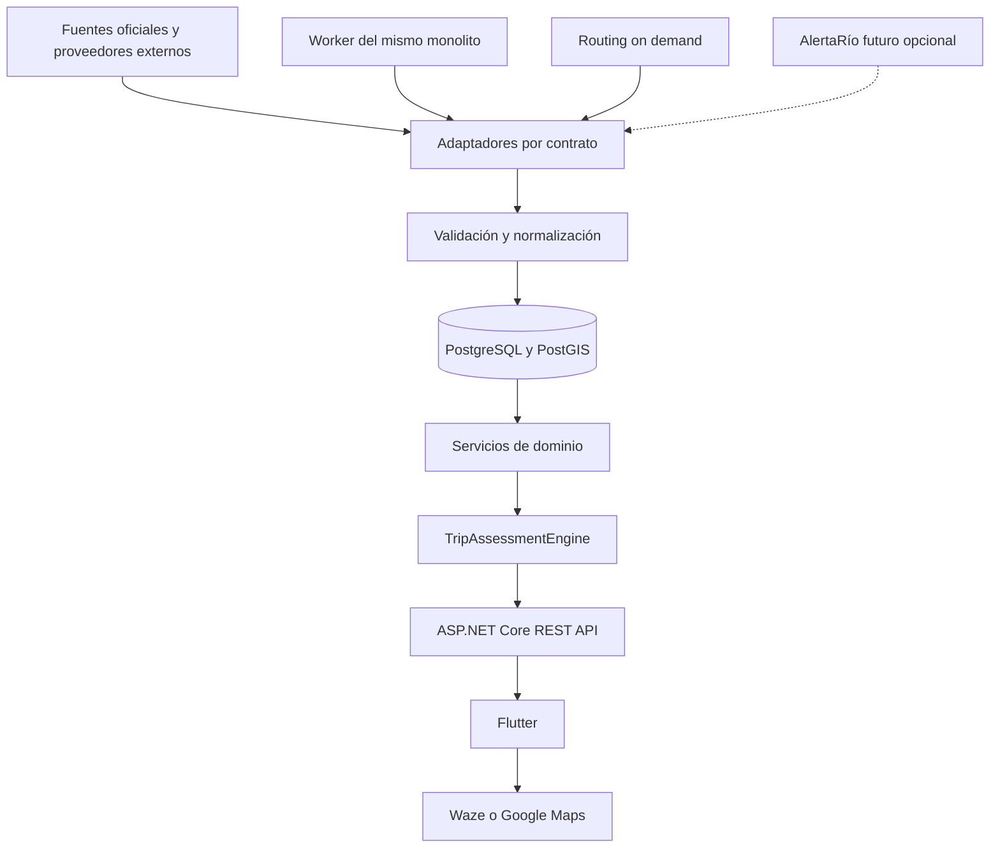
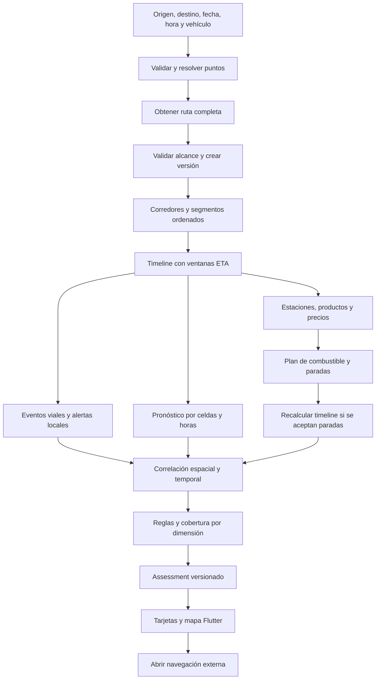

# Arquitectura técnica

**Monolito modular**, API REST y trabajos de ingesta del mismo código. PostgreSQL + PostGIS como único almacenamiento necesario inicialmente. Flutter para cliente. .NET 10 LTS según [política oficial vigente](https://dotnet.microsoft.com/en-us/platform/support/policy), con soporte publicado hasta noviembre de 2028; fijar el parche soportado al comenzar. La versión concreta de Flutter/PostgreSQL/PostGIS se fijará en la PoC según compatibilidad, sin usar prereleases por defecto.

## Módulos

| Módulo | Responsabilidad | No debe hacer |
|---|---|---|
| Trips | Casos de uso, snapshots y guardado | Interpretar payloads de proveedores |
| Routing | Adaptar ruta y capacidades | Calcular grafo propio |
| Geography | Localidades y matching GIS | Convertirse en catálogo mundial |
| RoadConditions | Normalización y afectaciones viales | Inferir cortes a partir de lluvia |
| Weather | Alertas, pronóstico y matching temporal | Diagnosticar certeza meteorológica |
| Fuel | Consumo, costos y plan alcanzable | Garantizar stock/precio futuro |
| Assessment | Reglas explicables y cobertura | Acceder directamente a HTTP externo |
| Identity | Propiedad, sesiones y autorización | Almacenar tracking |
| Operations | Ingestas, salud, métricas | Exponer secretos al cliente |

Inicialmente proyectos futuros `RutaSmart.Api`, `RutaSmart.Core`, `RutaSmart.Infrastructure`, `RutaSmart.Tests`; módulos por carpetas dentro de ellos. Core no depende de Flutter, EF ni DTO externos. Evitar un proyecto/servicio por entidad. DbContext directo en Infrastructure con consultas concretas; sin repositorio genérico obligatorio, MediatR/CQRS ni Event Sourcing.

## Diagrama de componentes

Desplegar API y worker como un proceso al principio con `BackgroundService`, locks/leases en PostgreSQL y trabajos durables. Separar proceso worker usando la misma imagen si la ingesta consume recursos o se escala API. No crear microservicios. Un único ejecutor por fuente mediante lease; reinicios recuperan trabajos vencidos.

## Flujo principal

Las paradas sugeridas no alteran silenciosamente la ruta analizada: el usuario las acepta y se crea una nueva versión. El motor puede simular un plan para explicar autonomía; distingue simulación de itinerario adoptado.

## Interfaces justificadas

- `IRoutingProvider`: frontera real entre motor externo y ruta canónica, con capabilities.
- `IWeatherProvider`: separar métodos/adaptadores de alertas oficiales y pronóstico; no forzar que un proveedor ofrezca ambos.
- `IRoadConditionProvider`: entrega snapshots/deltas normalizados con cobertura; no una lista sin semántica de completitud.
- `IFuelPriceProvider`: distingue precio de inventario de estaciones; admite fuentes oficiales o licenciadas, no input privado global.
- `IGeographicProvider`: búsqueda/normalización externa. GIS interno usa servicios concretos de PostGIS, no una abstracción universal de mapas.
- `IHydrologyProvider`: contrato documentado como futura extensión; **no implementar interfaz vacía, proyecto ni llamadas ahora**.

Los contratos incluyen `DataAvailability`, timestamps, versiones, atribución y errores tipados. No hay fallback automático a cualquier proveedor si viola licencia o pierde capacidades necesarias.

## Ingesta y consulta

Los siguientes intervalos son **políticas internas iniciales**, no frecuencia garantizada de la fuente. Sólo activar polling autorizado.

| Datos | Estrategia | Política inicial / fallo |
|---|---|---|
| Carreteras | Ingesta previa versionada | Revisión mensual o nueva edición; snapshot previo con fecha |
| Estaciones | Ingesta previa | Revisar cambios semanalmente; auditoría de operación separada |
| Precios | Ingesta previa sólo de fuente habilitada | Intento horario si contrato lo permite; evaluación de antigüedad por fila |
| Alertas oficiales | Ingesta previa, delta/cancelación | Objetivo 5 min si permitido; vigencia y salud independientes |
| Vialidad | Ingesta previa | Objetivo 15 min si permitido; nunca prometer esta cadencia al usuario |
| GeoRef | Búsqueda cacheada / catálogo autorizado | Cache propuesta 30 días; punto confirmado por usuario |
| Routing | On demand | Cache propuesta 6 h para ruta estática, limitada por licencia; tráfico requiere política distinta |
| Pronóstico | On demand por celda/ciclo | Cache propuesta 30 min, sin extender validez del pronóstico |
| Assessment | On demand | Reusar hasta 5 min sólo si versiones/horario/input no cambiaron |

Retries acotados con jitter para timeout/429/5xx, `Retry-After`, ningún retry a errores de validación/autorización. Máximo 2 reintentos en jobs; requests interactivos sujetos al presupuesto global. Circuit breaker propuesto: abrir 60 s después de 5 fallos consecutivos, una prueba half-open; ajustar a tráfico observado. No convertir la prueba en tormenta de reintentos.

Jobs idempotentes con ID de fuente, revisión/hash, staging de importación, validación y publicación atómica. Alerta por payload inesperado, caída brusca de filas o cambios de esquema. Congelar actualización ante corrupción, sin borrar lote anterior. Reprocesamiento manual con auditoría.

## Presupuesto de consultas y latencia

Por análisis: **objetivo <=8 requests HTTP externos, techo 12 incluyendo reintentos**. Propuesta de distribución máxima: 1 routing principal, hasta 4 lotes de pronóstico, hasta 4 consultas de desvíos/matriz, hasta 3 reintentos distribuidos. Localidades se resuelven antes, con su propia cuota. Alertas/vialidad/estaciones vienen de DB, no multiplican llamadas por segmento.

Hasta 32 muestras meteorológicas agrupadas inicialmente; si resolución o ruta requiere más, aplicar cache/lotes o declarar cobertura parcial. No fingir precisión sobre cientos de kilómetros sólo para cumplir límite. Matriz hasta 64 pares facturables por análisis como presupuesto propio inicial; el adaptador aplica además límites del proveedor. Sin presupuesto para validar desvío, entregar estaciones candidatas, no recomendación certificada.

Timeout total propuesto 15 s; objetivo p95 <8 s en beta medida; 3 llamadas externas concurrentes como máximo por análisis y semáforos globales por proveedor. Request coalescing para análisis idénticos, cuotas por sesión y circuitos de costo. No prometer percentiles antes del benchmark.

Redis: diferido. Cache local y PostgreSQL bastan para una instancia. Introducir Redis sólo por evidencia de múltiples réplicas, contención o rate limiting distribuido que PostgreSQL no resuelva dentro del objetivo. Notificaciones: FCM posterior con tokens opt-in, jobs de reevaluación y deduplicación de cambios, sin tracking continuo obligatorio.
