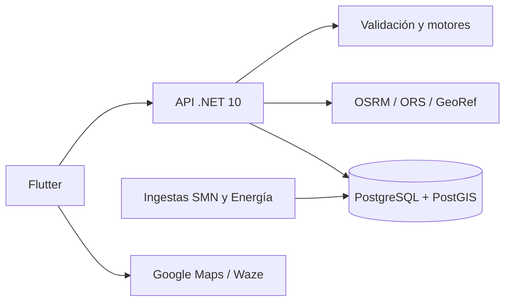

# Arquitectura

| Directorio | Responsabilidad |
|---|---|
| `src/RutaSmart.Core` | Modelos, validación, consumo, tiempos, alertas y estaciones |
| `src/RutaSmart.Infrastructure` | HTTP de proveedores, parsers y almacenamiento |
| `src/RutaSmart.Api` | Endpoints, propiedad, cuotas y trabajos periódicos |
| `mobile/rutasmart/lib` | Interfaz, cliente HTTP y guardado local |
| `infrastructure` | Compose, imagen .NET y migración SQL |
| `tests` | Dominio, API, PostGIS y navegador |

## Un análisis

Validar entrada → calcular ruta → estimar horarios y combustible → cruzar alertas → seleccionar estaciones → evaluar cobertura → guardar snapshot.

Cada informe conserva entrada, ruta, versión de reglas, fecha de cálculo y vigencia. Una nueva evaluación incrementa su versión. PostgreSQL guarda sesiones, informes, idempotencia y fuentes; la migración es `infrastructure/db/001-initial.sql`. En desarrollo puede usarse memoria.

## Reglas de cálculo

- **Consumo:** km × L/100 km ÷ 100. Compras mínimas: máximo entre cero y consumo + reserva − combustible inicial. Sin precio manual, los costos son nulos.
- **Tiempo:** duración distribuida proporcionalmente a la distancia, más pausas. La ventana usa ±20% de la conducción acumulada, con mínimo de 15 minutos; no incluye tráfico.
- **Alertas:** geometría WGS84; intersección por arista y solapamiento con la ventana de paso. Se preservan huecos y entradas repetidas. No se deduce un corte vial de una alerta meteorológica.
- **Estaciones:** hasta 20 candidatos distribuidos por el recorrido, a menos de 5 km laterales y con producto compatible. Distancia lateral no equivale a desvío por carretera.
- **Precios:** se conserva fecha y horario declarados. Referencias de más de siete días no se consideran comparables.
- **Estado:** adverso → precaución → información insuficiente → favorable. Solo puede ser favorable si las dimensiones críticas tienen cobertura suficiente.

Metros y segundos en los contratos; ARS y litros en decimal. `fetchedAt` indica descarga, no actualización del dato.

## Ingesta

SMN cada 5 minutos; Energía cada 6 horas. Un lote inválido conserva el snapshot anterior y su fecha. CAP contempla actualizaciones y cancelaciones. Las frecuencias son políticas de RutaSmart, no garantías de las fuentes.

La API está diseñada para **una instancia**. No hay leases ni cuotas distribuidas. Los trabajos de ingesta no consultan ni almacenan tracking de usuarios.
