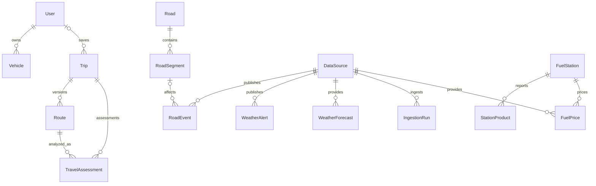

# Dominio y modelo de datos

Modelo lógico propuesto. No se generaron migraciones. Usar nombres ingleses estables en contratos y textos españoles en UI.

## Agregados y tablas

| Entidad / valor | Persistencia y campos esenciales | Razón |
|---|---|---|
| User | UUID, subject de identidad, creado/borrado | Propiedad; no guardar ubicación en perfil |
| Vehicle | ownerId, etiqueta, marca/modelo/año opcionales, fuelType, tankLitres, consumptionLPer100Km, consumo ciudad opcional | Datos manuales; no catálogo automotor inicial |
| Trip | ownerId nullable con sesión anónima, origen/destino confirmados, salida UTC/zona, snapshot de vehículo, paradas, save flag, expiración | Viaje guardado y análisis comparten agregado; no tabla SavedTrip duplicada |
| Route | tripId, version, proveedor/perfil, hash, línea, metros/segundos, generado, expiración/licencia, limitaciones | Inmutable por versión; evita mezclar recorridos |
| RouteSegment | routeId, ordinal, offsets de geometría, metros/segundos acumulados, referencias | Value objects serializados al principio; tabla sólo si se necesita consulta persistente |
| TravelAssessment | tripId/routeVersion, version, ruleVersion, status, coverage, reasons, fuelPlan, computedAt, validUntil | Snapshot inmutable reproducible; TripAssessment es alias del resultado, no segunda entidad |
| Road | id, jurisdicción, provincia nullable para nacional, código, denominación, procedencia | RN y RP no se confunden |
| RoadSegment | roadId, externalId, geometría, sentido, kmFrom/kmTo nullable, versión cartográfica | Referencia territorial; no es RouteSegment |
| RoadEvent | sourceId/externalId/revision, kind, severity, geom nullable, road/segment refs, sentido, vehículos afectados, validez, fechas, precisión, estado de publicación | Closure/Restriction/Construction/SurfaceCondition son tipos, no cuatro jerarquías de tablas |
| RoadStatus | Proyección calculada por tramo/instante con eventos y cobertura | No sobreescribir el registro de eventos con un estado único |
| FuelStation | id, sourceId/externalId, nombre/bandera, ubicación, precisión, reviewedAt, estado conocido | Separar existencia de estación y precio |
| StationProduct | stationId, fuelType, sourceId, fecha, evidencia | Producto reportado no garantiza stock |
| FuelPrice | stationId, producto, amount decimal, currency, unit, declaredAt, observedAt, sourceId, condiciones/pago opcionales | Identidad por estación/producto/fecha/condición |
| WeatherAlert | emisor/ID/revisión, fenómeno, nivel original, geom/zona, emisión, validez, cancelación/reemplazo, sourceId | Storm/Wind/Rainfall etc. son fenómenos |
| WeatherForecast | proveedor/modelo/ciclo, celda/punto, validFrom/to, variables y unidades, resolución, fetchedAt | Temperature/Visibility no son entidades independientes |
| DataSource | procedencia, licencia, coverage contract, timestamps, estado D/T/L | Gobernanza y trazabilidad |
| IngestionRun | fuente, inicio/fin, versión, hash, conteos, errores, snapshot completo/parcial | Operación idempotente |
| Location | Value object: label, punto, ID GeoRef opcional, precisión | Evita tabla global de domicilios de usuarios |
| FuelType | Enum/versionado: nafta grado 2/3, diésel grado 2/3 | No convertir todos los productos a “nafta” |

Fuente de precio manual: valor en snapshot del viaje con procedencia `user_input`; no se agrega al catálogo global ni se llama oficial.

## Relación de entidades

Un evento puede afectar varios tramos: implementar relación many-to-many cuando la PoC lo requiera; el diagrama simplifica la asociación. Cada razón de assessment referencia IDs y versiones de evidencia, intervalo espacial y temporal y explicación propia.

## Decisiones de persistencia

PostgreSQL relacional para identidad, propiedad, fuentes, consultas e índices; JSONB para snapshots de resultados, variables y payload normalizado versionado. No poner todas las entidades en un único documento ni usar JSONB para evitar restricciones de integridad.

Geometry: Point para estaciones; LineString/MultiLineString para red/eventos; MultiPolygon para alertas. Eventos con ubicación desconocida conservan texto y `precision=unknown`; no usar punto (0,0). Geography indexada para distancias.

UTC `timestamptz`, intervalos semiabiertos `[from,to)`, zona IANA del viaje por separado. `issuedAt`, `sourceUpdatedAt`, `fetchedAt`, `validFrom`, `validTo` significan cosas distintas. `validTo=null` es desconocido, no vigente para siempre.

Dinero decimal en ARS, unidad explícita; metros y segundos internamente. Datos sintéticos y reales nunca comparten un sourceId productivo. Restricciones: cantidades positivas; tanque mayor que combustible inicial; consumo >0; fin posterior al inicio; uniqueness `(sourceId,externalId,revision)`; ordinal de segmento único por versión.

El tanque es capacidad; el combustible inicial es input del viaje. Guardar sólo el tanque no permite calcular autonomía disponible. El snapshot conserva consumo/reserva usados aunque luego se edite el vehículo.

Raw payload opcional y restringido por licencia: retención limitada, comprimido y sin PII innecesaria. Publicar sólo DTO propios; no redistribuir respuestas originales si no está autorizado. `canPersistGeometry` y retención de proveedor pueden obligar a guardar sólo solicitud/preferencias y recalcular al abrir un viaje.

## Invariantes

1. Assessment pertenece exactamente a una versión de ruta, horario, vehículo y reglas.
2. No hay severidad negativa por ausencia de filas.
3. Una cancelación enlaza evento original; no pierde auditoría.
4. Un lote inválido no reemplaza el último snapshot válido.
5. Precio antiguo conserva fecha original al ser reingerido.
6. Cruce espacial no implica afectación vial sin vínculo de vía/sentido.
7. No se aplica conversión L ↔ m³ implícita.
8. Ningún recurso personal puede consultarse con sólo adivinar su UUID.
