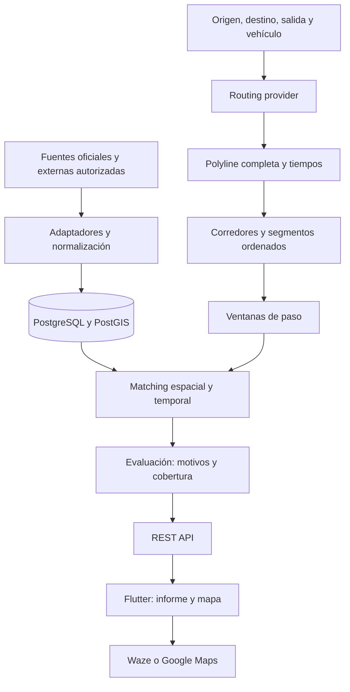

# PLAN MAESTRO DE DESARROLLO — RUTASMART ARGENTINA

Entrega: **30 de septiembre de 2026**. Investigación realizada el 29 de septiembre de 2026. Estado: diseño previo a implementación; ninguna aplicación, infraestructura ni integración productiva creada.

Este documento reúne las decisiones y el orden de desarrollo. Los documentos enlazados contienen las especificaciones detalladas y forman parte del plan. Las cifras de TTL, tolerancias, rendimiento, esfuerzo y presupuesto son propuestas internas salvo que se atribuyan expresamente a una fuente.

## 1. Resumen ejecutivo

RutaSmart es una capa de inteligencia para viajes por carretera en Argentina: relaciona itinerario, hora estimada de paso, condiciones viales y meteorológicas y necesidades de combustible. Entrega un informe explicable y después abre Waze o Google Maps.

**La arquitectura es viable para un desarrollador individual; la promesa completa del MVP todavía depende de validar datos.** La investigación confirmó documentación y una respuesta real de GeoRef, pero no un contrato público utilizable de alertas SMN ni de eventos de Vialidad. El antiguo régimen obligatorio de precios de surtidor fue derogado en 2025. Estas limitaciones deben resolverse antes de prometer integración nacional automática.

Se propone Flutter, ASP.NET Core .NET 10 LTS y PostgreSQL/PostGIS, con un monolito modular. ORS es candidato inicial de PoC, no proveedor definitivo. MapLibre es renderer preferido sujeto a compatibilidad y licencia de tiles. No hacen falta microservicios, Kubernetes, navegación propia ni IA.

## 2. Problema

El usuario encuentra información fragmentada por localidades, provincias y organismos. Debe decidir por su cuenta si un aviso corresponde a su camino y horario. RutaSmart debe reducir ese trabajo sin transformar la falta de información en una señal de tranquilidad. Ver [visión](VISION.md).

## 3. Usuarios

Primero: conductores particulares y familias que preparan viajes interurbanos en automóviles nafta/diésel. Después: viajeros frecuentes y empresas. Camiones, transporte regulado, GNC/bifuel y vehículos eléctricos necesitan modelos y restricciones diferentes; quedan fuera del cálculo inicial.

Validar necesidades mediante entrevistas y pruebas de comprensión, todavía no realizadas. No asumir demanda comercial demostrada por la existencia de la idea.

## 4. Propuesta de valor

Responder qué condiciones podrían coincidir con el viaje, dónde y aproximadamente cuándo, con fuente, fecha y límites. Presentar razones, no un puntaje opaco ni una garantía de seguridad. Diferenciar procedencia oficial/externa/manual de resultados calculados/estimados.

El negocio futuro puede incluir premium B2C, flotas, logística, agro, turismo, seguros y municipios, o API B2B. Cada segmento requiere validar demanda, licencias, costos y responsabilidad. [VISION.md](VISION.md) detalla hipótesis; no se implementan pagos ni multiempresa ahora.

## 5. Competidores

Google Maps y Waze resuelven navegación y tráfico; son complementos. Ruta0 es una referencia cercana en planificación, distancias, GNC y peajes; Rutas.ar en presentación de estado vial. Portales provinciales, SMN, Meteored y aplicaciones de combustible resuelven partes de la necesidad.

La diferenciación propuesta es correlación de evidencia con recorrido y ventana de paso. No se afirma que ningún competidor la ofrezca: falta prueba funcional comparativa. La [matriz de competencia](PRODUCT.md) enlaza publicaciones primarias y distingue funcionalidades verificadas de inferencias.

## 6. Investigación de APIs

Se separan tres verificaciones: **D**, documentación; **T**, respuesta técnica real; **L**, permiso para acceso, almacenamiento, redistribución y uso comercial concreto. Una fuente necesita además calidad y operación demostradas para producción.

GeoRef pasó una consulta técnica. Las APIs de routing tienen documentación identificada, pero no se probaron con cuentas del proyecto. Vialidad y SMN publican información; no se confirmó un feed integrable con contrato/permiso suficiente. No se inventaron endpoints para suplir ese vacío. [Registro de pruebas](docs/research/VERIFICATION.md).

## 7. Routing providers

| Proveedor | Evaluación para RutaSmart |
|---|---|
| OpenRouteService | Primer candidato PoC; revisar condiciones actuales de HeiGIT y límites de viajes largos/alternativas |
| OSRM | Alternativa autoalojable; operación y actualización del grafo propias; demo no productiva |
| GraphHopper | Alternativa SaaS con plan comercial; motor abierto no equivale a todas las funciones del servicio |
| Valhalla | Motor autoalojable potente; complejidad operativa superior a la necesidad inicial |
| Google | Evaluar Routes API para nuevo desarrollo; restricciones cartográficas y de cache condicionan arquitectura |
| HERE | Confirmar elegibilidad de uso y tarifa, además de cobertura |
| Mapbox | Candidato económico; revisar contrato de visualización y persistencia |

La [comparativa completa](ROUTING.md) incluye costos observados, límites, geometría, instrucciones, matrices, self-hosting y dependencia. No se midió precisión argentina: se propone un corpus de 12 recorridos. No usar los 1.450 km del ejemplo como distancia real de Urdinarrain–Bariloche.

## 8. Fuentes oficiales

| Fuente | Aporte potencial | Límite actual |
|---|---|---|
| Vialidad | Transitabilidad, restricciones, obras, cortes | Publicación verificada; integración automática no aprobada |
| Transporte/DNV | Ejes de rutas nacionales | Catálogo geográfico; descarga probada falló en herramienta; no equivale a estado operativo |
| Energía | Estaciones y referencias de precios | Archivos no auditados; precios recientes no garantizados |
| SMN | Alertas, advertencias, ACP y pronósticos | Feed autorizado/geometría/validez por verificar |
| INA | Observaciones y pronóstico hidrológico | API documentada parcialmente; impacto vial requiere evidencia adicional |
| GeoRef | Nombres, códigos y centroides | No reemplaza punto domiciliario confirmado ni routing |

La [Resolución 717/2025](https://www.argentina.gob.ar/normativa/nacional/resoluci%C3%B3n-717-2025-413477/texto) derogó la 314/2016. No es válido inferir actualización actual por el plazo de reporte del régimen derogado. Ver [DATA-SOURCES.md](DATA-SOURCES.md) para formatos, frecuencias publicadas, licencias, cobertura y acciones pendientes. No hubo scraping ni contacto con organismos.

## 9. MVP

Origen/destino confirmados, fecha/hora, ruta, distancia, duración, identificación RN/RP con cobertura, eventos viales y alertas habilitados, estaciones candidatas, precio cuando sea válido, consumo/costo, vehículo/viaje guardado y navegación externa.

Cuenta y GPS opcionales. Precio ausente produce costo nulo o referencia manual identificada. Sin datos críticos suficientes, el informe lo dice. Recomendación de carga completa sólo con acceso vial y factibilidad comprobados; candidatos por corredor no se etiquetan como plan garantizado.

Si no se resuelven feeds oficiales, una beta de ruta/combustible puede ser útil, pero **no constituye el MVP completo solicitado**. [Alcance y UX](PRODUCT.md).

## 10. Arquitectura

Monolito modular, API REST, jobs del mismo código y PostgreSQL/PostGIS. Módulos de viajes, routing, geografía, vialidad, meteorología, combustible, evaluación, identidad y operación. Contratos normalizados aíslan proveedores.

Cache local/DB al principio; Redis cuando una medición justifique su costo. Worker separado como proceso si es necesario, sin convertirlo en microservicio. FCM y seguimiento de viajes después del MVP. [Arquitectura detallada](ARCHITECTURE.md).

## 11. Diagramas

El diagrama de componentes y el flujo con paradas están en [ARCHITECTURE.md](ARCHITECTURE.md); el diagrama de entidades está en [DOMAIN.md](DOMAIN.md).

## 12. Modelo de dominio

Trip, Route, Vehicle, FuelStation, FuelPrice, WeatherAlert, WeatherForecast, Road/RoadSegment/RoadEvent, TravelAssessment y DataSource. Location y RouteSegment pueden ser value objects. SavedTrip es un estado de Trip; Closure/Restriction/Construction son tipos de evento. Evitar entidades independientes para cada variable meteorológica.

Toda evaluación referencia una versión exacta de ruta, salida, vehículo, reglas y evidencia. [Entidades e invariantes](DOMAIN.md).

## 13. Modelo de datos

Relacional para propiedad, integridad y consultas; JSONB para snapshots/versiones de resultado. Geometrías WGS84 SRID 4326; medidas geodésicas en metros, duración en segundos, consumo en litros y dinero decimal con moneda.

Separar emisión, actualización de fuente, recepción y validez. `validTo=null` es desconocido, no eterno. Fechas UTC y zona IANA del viaje. Un precio descargado hoy conserva fecha declarada. Guardar geometrías externas sólo si licencia lo permite.

## 14. GIS

PostGIS para prefiltro indexado y predicado exacto. `ST_DWithin` con geography para distancia métrica; `ST_Intersects` para línea y polígonos. Identificación vial por jurisdicción, código, dirección y continuidad, no sólo cercanía.

GiST sobre geometrías/geography; B-tree sobre IDs/versiones/fechas. Validar CRS, geometrías inválidas, huecos, vías paralelas y cruces a distinto nivel. [GEOSPATIAL.md](GEOSPATIAL.md).

## 15. Route Corridor

Corredor = selección de candidatos. Estaciones: radio lateral inicial de 5 km, ampliable a 10/25 km si conviene; acceso final por red. Alertas: intersección real; cercanía separada como contexto. Eventos viales: tolerancia estrecha más identidad de vía/sentido. Hidrología futura: vínculo con infraestructura, no radio universal.

Estas distancias son propuestas a calibrar, no umbrales de seguridad. No utilizar buffer de 25 km para declarar todo lo que encuentra como afectación.

## 16. Segment Timeline

ETA acumulada desde la salida usando tiempos por tramo y paradas. Interpolación local dentro del edge; si sólo hay duración total, proporcionalidad por distancia como fallback de baja confianza.

Ventana inicial de sensibilidad propuesta: ±máximo entre 15 minutos y 20% de conducción acumulada. No es intervalo estadístico calibrado. Conservar múltiples pasadas en bucles, medianoche y cambios de fecha. Mostrar “Estimación basada en duración prevista del recorrido”.

## 17. Road Condition Engine

Normaliza corte, restricción, obra, superficie y precaución. Determina aplicabilidad por tramo, sentido, categoría de vehículo, tiempo y precisión. Un km de carretera requiere referencia oficial calibrada; no equivale a distancia desde el origen del viaje.

No inferir reapertura por desaparición de un feed parcial. Corte viejo sin confirmación conserva advertencia de vigencia incierta. Conflictos entre fuentes quedan visibles. [Reglas viales](TRIP-ANALYSIS.md).

## 18. Weather Matching

Intersectar la ruta original con el área y obtener entrada/salida estimada. Evaluar solapamiento con validez del aviso; distinguir coincidencia central de coincidencia sólo en banda de incertidumbre. Alerta vencida antes de llegada temprana no afecta ese paso.

Forecast por celdas/horas agrupadas; resolución del modelo visible. No sustituir observación por pronóstico ni proveedor externo por alerta SMN. Fuera de horizonte hay información insuficiente. Umbrales de conducción requieren validación especializada antes de beta.

## 19. Fuel Engine

Litros = km × L/100 km ÷ 100. Autonomía útil = (litros actuales − reserva) × 100 ÷ consumo, con piso cero. Combustible inicial pertenece al viaje; capacidad de tanque pertenece al vehículo. Diferenciar combustible consumido de litros comprados y desembolso.

Ejemplo sintético: 1.200 km a 7,5 L/100 km son 90 L. Con inicio 30 L y reserva final 5 L hacen falta al menos 65 L de compras, sin desvíos. No hay precio actual supuesto. Ranking: factibilidad, acceso/calidad, desvío y luego precio comparable; no sumar magnitudes incompatibles en un score.

Plan multietapa acotado con estaciones alcanzables y continuidad hasta destino; sin datos suficientes, declararlo. Producto reportado no garantiza stock. [Fórmulas y casos](TRIP-ANALYSIS.md).

## 20. Trip Assessment Engine

| Evidencia | Resultado principal |
|---|---|
| Corte impeditivo o condición adversa conocida aplicable | CONDICIONES ADVERSAS, aunque también falte otra fuente |
| Motivo de precaución aplicable | PRECAUCIÓN y cobertura explícita |
| Sin motivos conocidos pero faltan fuentes críticas | INFORMACIÓN INSUFICIENTE |
| Sin motivos y cobertura crítica suficiente | CONDICIONES FAVORABLES, sin garantía de seguridad |

Razones trazables, reglas versionadas y calidad por dimensión. Falta de precio no es adversidad meteorológica; hidrología no es cobertura crítica del MVP. Frase válida: “No se detectaron advertencias relevantes en las fuentes consultadas”. Nunca “Es seguro viajar”.

## 21. REST API

Contrato propio versionado: análisis, lectura/guardado de viajes, vehículos, localidades y salud resumida. Sesiones anónimas temporales y cuenta opcional. POST idempotente; ownership en cada recurso; errores Problem Details y respuesta parcial explícita.

[API.md](API.md) explica semántica. [docs/openapi.json](docs/openapi.json) contiene la especificación OpenAPI 3.1 propuesta. Son endpoints por desarrollar, no endpoints atribuidos a proveedores externos. GET de informe no dispara reanálisis silencioso.

## 22. Flutter

Flujo Home→análisis→resumen→tarjetas/mapa→navegación. Capas por features, HTTP separado, modelos según contrato, tokens protegidos y guardado local. Mostrar información útil aunque falle el mapa; colores acompañados por texto/semántica accesible.

Renderer encapsulado, atribuciones visibles, clustering/filtros según volumen. El navegador externo puede elegir otra ruta: se avisa junto al botón, sin prometer transferencia exacta de polyline. Android primero como propuesta de beta; iOS requiere decisión y validación propia.

## 23. Seguridad

OIDC/PKCE para cuenta, validación JWT, tokens anónimos opacos temporales, refresh según proveedor y secure storage. HTTPS, autorización por objeto, límites de input/concurrencia/costo, allowlist de proveedores, SQL parametrizado, secretos server-side y circuit breakers.

No confiar en UUID como permiso de acceso. No admitir geometrías arbitrarias enormes ni URLs externas suministradas por usuario. [SECURITY.md](SECURITY.md).

## 24. Privacidad

Sin tracking continuo. Ubicación puntual opt-in y búsqueda manual. Viajes anónimos backend 24 h; guardado voluntario con borrado; logs sin coordenadas; backups con expiración y borrados reaplicados después de restore. Son políticas propuestas, no plazos legales atribuidos a una norma.

Antes de datos reales: responsable, aviso de privacidad, derechos, transferencias y proveedores revisados para el caso concreto bajo marco argentino. Nuevas funciones de seguimiento requieren una finalidad y consentimiento separados.

## 25. Testing

Tests de dominio, integración PostGIS real, adaptadores con fixtures, API/ownership/idempotencia, Flutter unit/widget/integración, carga y recuperación. No depender de Internet en CI. Mocks sintéticos distinguidos de respuestas reales autorizadas.

[TESTING.md](TESTING.md) contiene 32 casos, incluidos todos los escenarios solicitados. [Fixtures](docs/fixtures/scenarios.json) inicia corpus espacial/temporal y de combustible. No se afirma que esos tests de aplicación ya existan o hayan pasado.

## 26. DevOps

Docker/Compose local; staging y producción separados. CI propuesta en GitHub Actions con contrato, lint, tests, integración DB, build, escaneo y despliegue de la misma imagen. Migraciones como job único con rol separado. Backup cifrado externo, restore ensayado y rollback compatible.

Comparación de VPS Hetzner, Render y Railway, presupuesto por unidades y límites en [DEPLOYMENT.md](DEPLOYMENT.md). Propuesta preliminar de beta: USD 30–100/mes de infraestructura y USD 0–150/mes de servicios, más impuestos/licencias posibles; rango de planificación, no cotización ni garantía. Recalcular después de PoC.

## 27. Observabilidad y performance

Dashboard por fuente: estado de acceso, frescura, cobertura, último éxito, errores, latencias, cuotas, cache y jobs. Métricas de calidad de coordenadas/fechas y costo por análisis. No usar rutas/usuarios como labels.

Presupuesto interno por análisis: objetivo <=8 requests externos, techo 12 con reintentos; hasta 32 muestras meteorológicas agrupadas y 64 pares de matriz como límites iniciales. Si falta presupuesto para resolver una dimensión, resultado parcial. No se promete precisión ficticia reduciendo muestras sin explicarlo.

Objetivo p95 <8 s en beta; deadline 15 s y consultas GIS p95 <500 ms en hardware declarado. Son objetivos por medir. Ingestar estaciones/red/alertas/estado previamente; routing y pronóstico específico on demand. Simplificar sólo geometría visual; índices y cache antes de escalar infraestructura.

## 28. Riesgos y mitigación

| Riesgo | Impacto | Mitigación / condición de salida |
|---|---|---|
| Fuente oficial sin API utilizable | Alto, bloquea función automática | Acceso autorizado/convenio; beta acotada explícita, sin endpoints internos |
| Actualización lenta o metadata engañosa | Alto, falso favorable | Separar recepción/emisión/validez y cobertura; medir edad real |
| Cortes sin georreferencia/km calibrado | Alto, falso matching | Precisión incierta, referencia lineal oficial, revisión acotada |
| Precios viejos/fin de obligación 314 | Alto para costo/ranking | Fechas por fila, referencia manual y costo nulo |
| Estaciones con coordenadas erróneas/cerradas | Alto para autonomía | Cuarentena, auditoría y acceso validado; stock no garantizado |
| Routing impreciso o cruza frontera | Alto | Corpus argentino, revisión de geometría, rechazo fuera de alcance |
| Navegador cambia itinerario | Alto para validez del informe | Aclaración visible; reevaluar ruta distinta, no asumir seguimiento |
| Pronóstico poco granular/horizonte insuficiente | Alto | Resolución y bandas explícitas; no extrapolar; parcial |
| Licencias incompatibles/vendedor cautivo | Alto | Matriz de derechos/capabilities; evitar mezclar datasets sin permiso |
| Costos de APIs y abuso | Alto | Metering por SKU/pares, quotas, límites monetarios y cache autorizado |
| Responsabilidad de recomendaciones | Alto | Razones/fuentes, incertidumbre comprensible, revisión jurídica y especialista |
| Uso offline con información vencida | Medio-alto | Snapshot fechado; no avisos actuales offline ni tiles sin licencia |
| Escala nacional heterogénea | Alto | Expandir por corredor y cobertura, no declarar uniformidad |
| Operador individual | Alto | Monolito, jobs durables, runbooks, alertas agrupadas y servicios gestionados |
| Impacto hídrico inferido sólo por río cercano | Alto | No incluir MVP; vínculo a infraestructura y umbrales validados |
| Pérdida/fuga de viajes personales | Alto | Minimización, ownership, retención, backups y restore con borrados |

Prioridad máxima: fuentes oficiales, derechos y calidad. Escalar servidores no resuelve esas restricciones.

## 29. Roadmap

[ROADMAP.md](ROADMAP.md) especifica las 15 fases, cada una con objetivos, tareas, dependencias, archivos futuros, aceptación, tests y riesgos: investigación; PoC routing; PoC datos; GIS; backend; combustible; clima; vialidad; evaluación; Flutter; mapas; testing; observabilidad; beta; producción.

La puerta F2 es determinante. Si no aprueba datos críticos, se revisa alcance antes de gastar esfuerzo en una aplicación que no pueda cumplir su promesa. Tests/observabilidad se incorporan desde los primeros adaptadores; sus fases finales consolidan.

## 30. Backlog

[BACKLOG.md](BACKLOG.md) organiza 12 épicas y 32 historias con feature, prioridad, complejidad, tareas, dependencias y aceptación Given/When/Then. No son issues enviados a un servicio externo.

El primer corte resuelve fuentes y routing; el segundo prueba motor con mocks declarados; el tercero sustituye por datos reales habilitados y completa MUST; después beta y evolución. Las historias bloqueadas por fuentes no se disfrazan como progreso de UI.

## 31. Priorización

MUST: núcleo del análisis honesto, fuentes habilitadas, ruta, timeline, GIS, consumo, costo disponible, autonomía/candidatos, guardado, mapa simple y salida a navegador, con seguridad/fallos.

SHOULD: plan de carga multietapa validado, forecast complementario, pausas editables y refinamientos de mapa. COULD: comparación de horarios, exportación y avisos posteriores. NOT NOW: navegación propia, crowdsourcing, red social, reservas, camiones/EV/GNC, hidrología automática y arquitectura distribuida. Detalles en [PRODUCT.md](PRODUCT.md).

## 32. Criterios de aceptación generales

1. Dado un recorrido soportado, cuando se analiza, se obtiene geometría coherente, distancia/duración estimadas y procedencia.
2. Dado un evento cercano no aplicable espacialmente, cuando se evalúa, no se presenta como afectación confirmada.
3. Dada alerta vencida antes del paso temprano, no se emite advertencia activa por ese cruce.
4. Dado fallo de fuente crítica, no aparece favorable por ausencia de resultados.
5. Dado corte conocido y otra fuente caída, aparecen tanto adversidad como insuficiencia.
6. Dado precio faltante, se calculan litros y costo nulo; no se inventa valor.
7. Dada estación inaccesible/incompatible, no integra una recomendación validada.
8. Dado informe guardado vencido, se muestra fecha y se ofrece reanálisis explícito.
9. Dado ID ajeno, no se permite acceso; borrados no reaparecen tras restore.
10. Dado cierre de beta, fuentes/licencias, casos críticos, presupuesto y recuperación tienen evidencia verificable.

## 33. Estimación relativa de complejidad

Mayor incertidumbre: acceso/calidad oficial y referencia vial. Complejidad alta: matching GIS/tiempo, multietapa de combustible y manejo de fallos parciales. Media: backend/auth, Flutter y operación. Baja: fórmula de consumo, inputs manuales y enlaces externos.

Escala relativa 1/2/3/5/8/13 por historia; no equivale automáticamente a horas. Rango orientativo propio: 18–28 semanas de trabajo efectivo individual experimentado con acceso a datos resuelto, más contingencia 25–35% si las PoC descubren problemas. Excluye espera de convenios y expansión iOS. Reestimar en F2 y F8, no prometer una fecha con fuentes aún bloqueantes.

## 34. Orden exacto de implementación

1. Cerrar alcance/corredores, evidencia D/T/L y presupuesto de PoC.
2. Probar routing real y compatibilidad de mapas/licencias.
3. Validar muestras oficiales, evolución temporal y calidad por al menos el periodo de PoC definido.
4. Aprobar o reformular el alcance si faltan fuentes críticas.
5. Implementar persistencia espacial, índices, matching y corpus de geometrías.
6. Implementar API básica, ownership, snapshots, idempotencia y jobs.
7. Implementar vehículo/consumo/reserva/candidatos y costo opcional.
8. Implementar timeline y matching meteorológico con revisiones/horizonte.
9. Implementar eventos viales, correspondencia y vigencia/conflictos.
10. Integrar assessment versionado con motivos y cobertura.
11. Construir Flutter y completar mapa, guardado y navegación externa.
12. Cerrar tests integrales, seguridad, rendimiento, dashboard y recuperación.
13. Ejecutar beta acotada; corregir comprensión, calidad y costos.
14. Publicar sólo después de cumplir puertas de producción; ampliar por evidencia.

AlertaRío, notificaciones, modo viaje y API B2B quedan como extensiones del motor, sin dependencia inicial ni base de datos compartida. El contrato futuro de hidrología exige área/intervalo, procedencia y relación demostrable con infraestructura.

## DECISIONES TOMADAS

- Capa de análisis, navegación delegada, sin promesa de seguridad.
- Monolito modular .NET, Flutter y PostgreSQL/PostGIS.
- Procedencia, calidad y tiempo como partes del dominio y la UX.
- Precios opcionales/fechados; combustible inicial y reserva por viaje.
- Sin scraping base, tracking continuo ni hidrología automática en MVP.
- Implementación condicionada por puertas de fuentes y licencias.

[Registro completo](DECISIONS.md) y [seis ADR](docs/adr/README.md).

## DECISIONES PENDIENTES

Acceso SMN/Vialidad; calidad/licencia de estaciones/precios; proveedor routing/tiles definitivo; corredores piloto; umbrales de forecast; presupuesto/hosting; identidad y revisión jurídica; inclusión de plan de carga avanzado; fecha de iOS. Cada pendiente tiene responsable propuesto y disparador en DECISIONS.md.

## APIs VERIFICADAS

**Documentación y respuesta real:** GeoRef `GET /localidades` para Urdinarrain, HTTP 200 JSON. No acredita SLA ni todos los endpoints.

**Documentación consultada, sin prueba end-to-end del proyecto:** ORS, OSRM, GraphHopper, Google Routes, HERE y Mapbox; INA mediante asistente oficial; Open-Meteo como complemento externo. Valhalla confirmado como motor y capacidades en repositorio, sin despliegue/API operativa probados. Los niveles de evidencia no son intercambiables.

## APIs NO VERIFICADAS

Feed público estable/autorizado de eventos viales DNV; feed de alertas/advertencias/ACP y pronóstico SMN aplicable a este proyecto; API actual de precios por estación; acceso operacional a series INA; servicios provinciales como APIs; cualquier futuro endpoint de AlertaRío. No se afirma que no existan: no se pudo confirmar un contrato utilizable en esta investigación.

## RIESGOS BLOQUEANTES

1. Sin feed oficial autorizado y suficiente, no se puede entregar detección automática de alertas del MVP.
2. Sin datos viales georreferenciables y sostenibles, no se puede prometer estado nacional automatizado.
3. Sin permiso de reutilización, una respuesta técnica no habilita publicación comercial.
4. Sin inventario de estaciones auditado, no se puede afirmar un plan de carga confiable.
5. Sin validar routing, licencia cartográfica y costos, no debe fijarse proveedor productivo.

La falta de precio actual es bloqueante para precio/ranking económico de esa estación, **no** para calcular litros con referencia manual o costo ausente. La falta de INA no bloquea el MVP definido.

## PRIMEROS 10 PASOS

1. Revisar este plan, priorización y promesa de cobertura.
2. Definir presupuesto de PoC y corredores piloto candidatos.
3. Preparar solicitudes de acceso/documentación a SMN y Vialidad; enviar cuando el responsable lo indique.
4. Obtener por canal autorizado inventario/precios de Energía y medir su calidad real.
5. Verificar condiciones actuales de cuenta ORS y de tiles compatibles.
6. Ejecutar el corpus argentino de routing y registrar tiempos, geometría, fallos y costos.
7. Probar fuentes reales con revisiones/cancelaciones y distinguir vacío de fallo.
8. Resolver por escrito la puerta de viabilidad: MVP completo o beta reducida explícita.
9. Congelar contrato canónico, reglas de cobertura y fixtures para el primer incremento.
10. Recién entonces comenzar el motor GIS y el backend básico, siguiendo ROADMAP.md.
