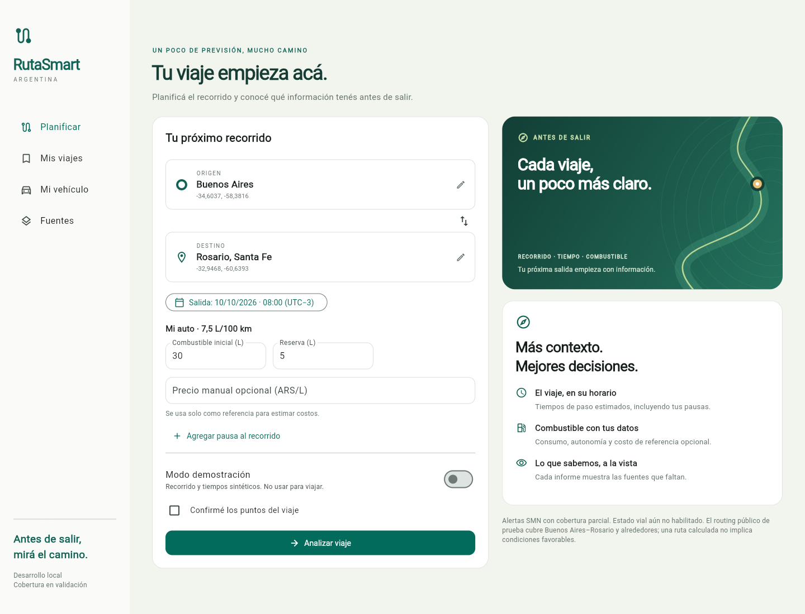
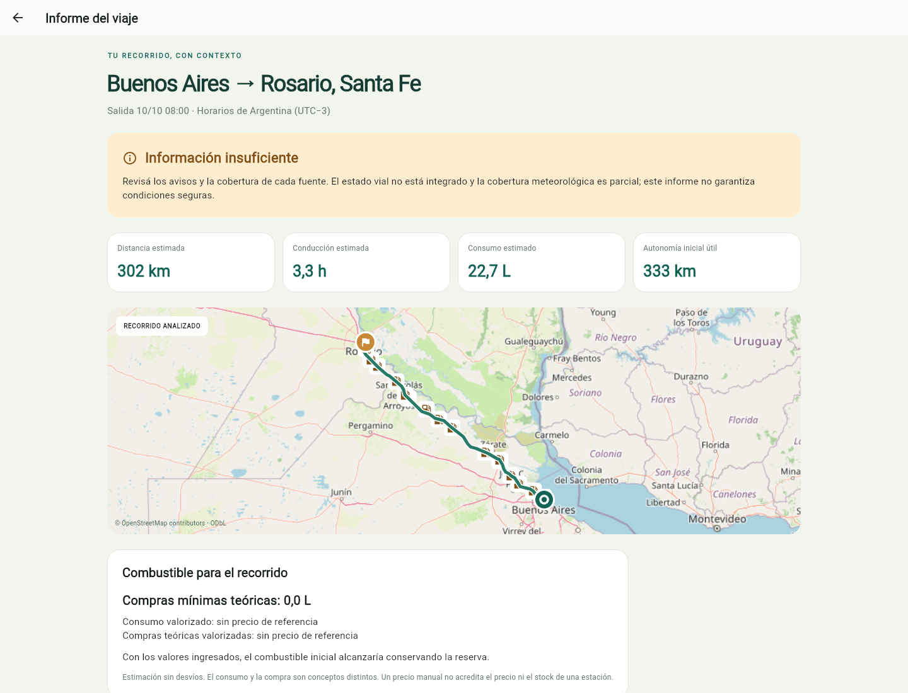
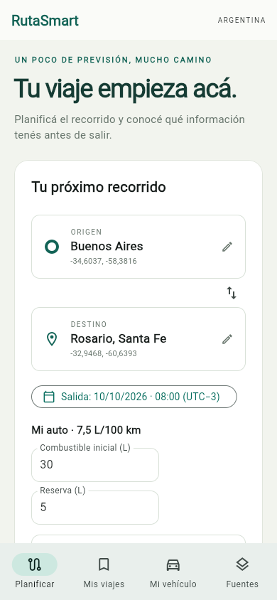
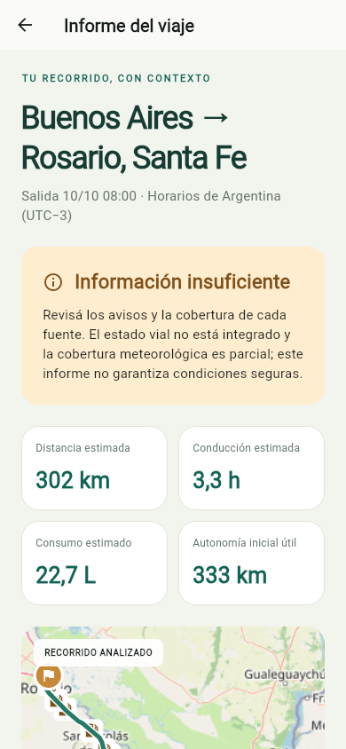

<div align="center">

# RutaSmart Argentina

### Un poco de previsión. Mucho camino.

Planificá tu recorrido, consultá alertas y estimá combustible antes de salir.

**Flutter · .NET 10 · PostgreSQL / PostGIS**

[Empezar](#ejecución-local) · [Estado del proyecto](PLAN-MAESTRO.md) · [Documentación](#documentación)

</div>



## Tu viaje, con contexto

- **Planificá:** origen, destino, salida, vehículo y pausas.
- **Explorá:** ruta real, alertas SMN y estaciones cercanas.
- **Calculá:** consumo, autonomía, reserva y costo de referencia.
- **Guardá:** informes en tu dispositivo; abrí Google Maps o Waze cuando quieras navegar.

Sin cuenta obligatoria. Cada informe muestra sus fuentes, fecha y límites.

## Así se ve



<p align="center">
  
  &nbsp;&nbsp;
  
</p>

Capturas reales del cliente web, tomadas con Chrome. El informe usa routing público OSRM; la vista de celular es una ventana de 390 × 844, no una captura de Android.

## Ejecución local

Requisitos: **.NET 10** y **Flutter 3.29.2**. Desde la raíz, en PowerShell:

```powershell
./scripts/run-local.ps1
```

Abrí **[localhost:5080](http://localhost:5080)**. El script compila el cliente y arranca la API. No requiere claves. Ctrl+C detiene el servidor.

Para conservar los datos en PostgreSQL, o compilar Android, consultá [ejecución y configuración](DEPLOYMENT.md).

## Estado actual

**Versión local funcional; MVP todavía incompleto.** El routing gratuito de prueba cubre Buenos Aires–Rosario y alrededores. SMN y Energía tienen cobertura parcial. Faltan estado vial integrado, routing nacional validado y un plan de carga con accesos por carretera. No hay cuentas sincronizadas ni despliegue productivo.

Una ruta calculada no implica condiciones favorables. Las estaciones son candidatas; su acceso y stock no están verificados.

## Desarrollo

```powershell
dotnet test RutaSmart.slnx
cd mobile/rutasmart
flutter analyze
flutter test
```

[Pruebas, capturas y resultados](TESTING.md). No se ejecutan consultas a fuentes públicas en CI.

## Documentación

| Buscás… | Guía |
|---|---|
| Alcance y próximos pasos | [Plan maestro](PLAN-MAESTRO.md) |
| Decisiones del proyecto | [Decisiones](DECISIONS.md) |
| Código, datos y cálculos | [Arquitectura](ARCHITECTURE.md) |
| Endpoints | [API](API.md) |
| Proveedores y límites | [Fuentes](DATA-SOURCES.md) |
| Configuración y builds | [Ejecución](DEPLOYMENT.md) |
| Privacidad y controles | [Seguridad](SECURITY.md) |

Cartografía: © OpenStreetMap contributors. Ruta: OSRM / FOSSGIS. Avisos: SMN. Estaciones y precios declarados: Secretaría de Energía. [Detalle de atribuciones](DATA-SOURCES.md).
