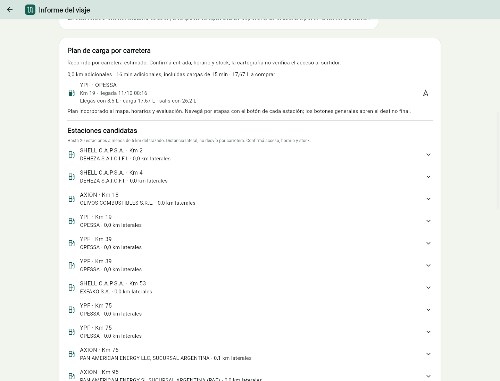
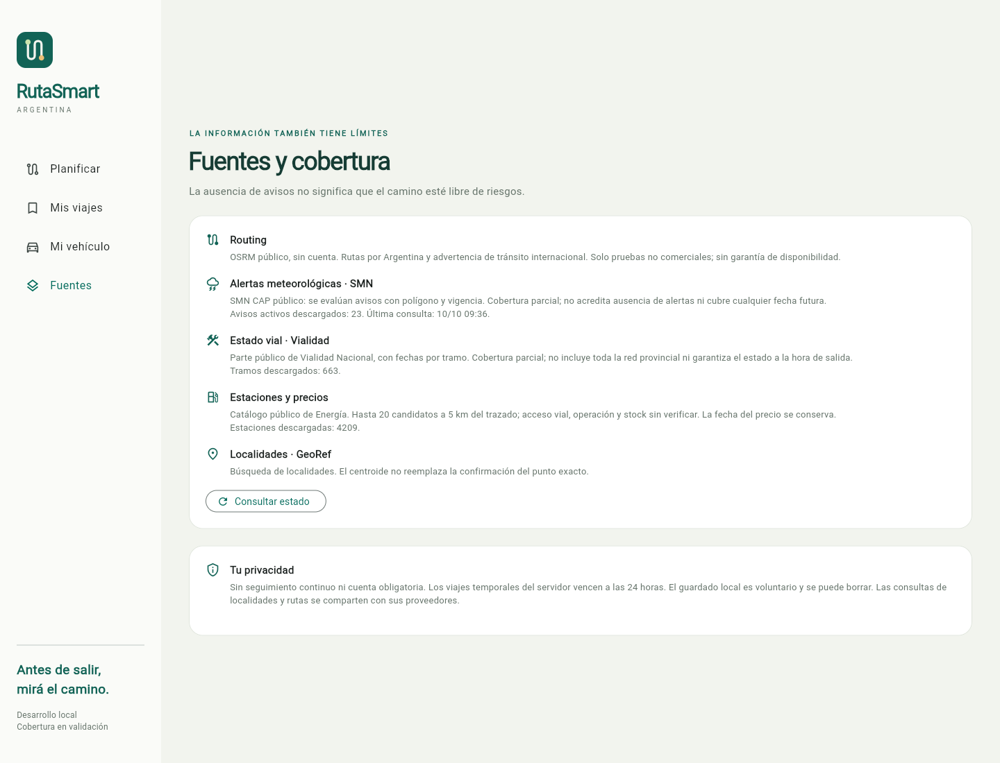

<div align="center">


# RutaSmart Argentina

### Un poco de previsión. Mucho camino.

Planificá tu recorrido, consultá alertas y estimá combustible antes de salir.

**Flutter · .NET 10 · PostgreSQL / PostGIS**

[Empezar](#ejecución-local) · [Estado del proyecto](PLAN-MAESTRO.md) · [Documentación](#documentación)

</div>


## Tu viaje, con contexto

- **Planificá:** origen, destino, salida, vehículo y pausas.
- **Explorá:** rutas en Argentina, partes de Vialidad y alertas SMN.
- **Calculá:** consumo, reserva y paradas de carga con distancias por carretera.
- **Guardá:** informes en tu dispositivo; abrí Google Maps o Waze cuando quieras navegar.

Sin cuenta obligatoria. Cada informe muestra sus fuentes, fecha y límites.

## Así se ve






<p align="center">
  
  &nbsp;&nbsp;
  
</p>

Capturas reales del cliente web, tomadas con Chrome. El informe usa routing público OSRM; la vista de celular es una ventana de 390 × 844, no una captura de Android.

## Ejecución local

Requisitos: **.NET 10** y **Flutter 3.29.2**. Desde la raíz, en PowerShell:

```powershell
./scripts/run-local.ps1
```

Abrí **[localhost:5080](http://localhost:5080)**. El script compila el cliente y arranca la API. No requiere claves. Ctrl+C detiene el servidor.

Para conservar los datos en PostgreSQL, o compilar Android, consultá [ejecución y configuración](DEPLOYMENT.md).

## Estado actual

**Versión local funcional.** Routing nacional probado en ocho recorridos regionales; Vialidad, SMN y Energía integrados con cobertura parcial. El plan de carga propone paradas, comprueba la reserva y recalcula el informe al confirmarlo. OSRM público se usa para pruebas no comerciales. No hay cuentas sincronizadas ni despliegue productivo.

Una ruta calculada no implica condiciones favorables. Vialidad se vincula por ruta nacional y provincia, sin localizar el corte exacto. El acceso cartográfico a una estación no garantiza entrada al surtidor, horario ni stock.

## Desarrollo

```powershell
dotnet test RutaSmart.slnx
cd mobile/rutasmart
flutter analyze
flutter test
```

[Pruebas, capturas y resultados](TESTING.md). No se ejecutan consultas a fuentes públicas en CI.

## Documentación

| Buscás… | Guía |
|---|---|
| Alcance y próximos pasos | [Plan maestro](PLAN-MAESTRO.md) |
| Decisiones del proyecto | [Decisiones](DECISIONS.md) |
| Código, datos y cálculos | [Arquitectura](ARCHITECTURE.md) |
| Endpoints | [API](API.md) |
| Proveedores y límites | [Fuentes](DATA-SOURCES.md) |
| Configuración y builds | [Ejecución](DEPLOYMENT.md) |
| Privacidad y controles | [Seguridad](SECURITY.md) |

Cartografía: © OpenStreetMap contributors y GeoRef (CC BY 4.0). Ruta: OSRM / FOSSGIS. Avisos: SMN y Vialidad Nacional. Estaciones y precios declarados: Secretaría de Energía. [Detalle de atribuciones](DATA-SOURCES.md).
